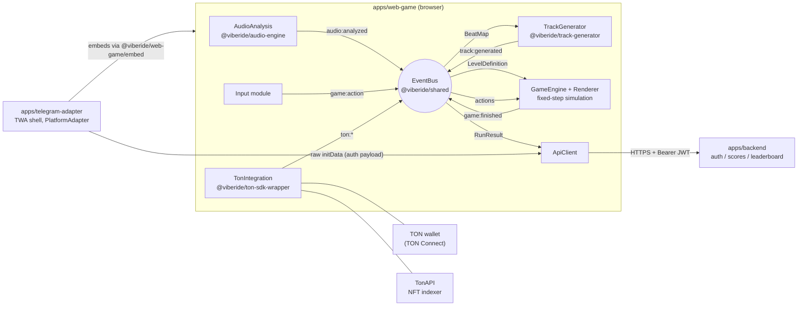

# VibeRide Architecture

VibeRide is a music-driven racing game (Hill Climb Racing × Piano Tiles × Geometry Dash): the
player supplies an audio file, the game analyzes it into a `BeatMap`, deterministically generates a
level synchronized to the music, and the player rides it. It ships as a plain web game and as a
Telegram Mini App, with optional TON blockchain integration (wallet, NFT skins) behind feature
flags.

The repository is a pnpm + Turborepo monorepo:

| Workspace                  | Package                      | Role                                                                                         |
| -------------------------- | ---------------------------- | -------------------------------------------------------------------------------------------- |
| `packages/shared`          | `@viberide/shared`           | Contracts: domain types, typed `EventBus`, zod API schemas, PRNG/hash, feature flags, Logger |
| `packages/audio-engine`    | `@viberide/audio-engine`     | Deterministic DSP: decode glue, FFT, spectral flux, onset/BPM detection → `BeatMap`          |
| `packages/track-generator` | `@viberide/track-generator`  | Deterministic `BeatMap` → `LevelDefinition` generation + playability validation              |
| `packages/ton-sdk-wrapper` | `@viberide/ton-sdk-wrapper`  | All TON functionality behind one `TonModule` interface (TON Connect, payloads, NFT lookup)   |
| `apps/web-game`            | `@viberide/web-game`         | Browser game: game engine, renderer, input, UI shell, embeddable `createGame` entry          |
| `apps/telegram-adapter`    | `@viberide/telegram-adapter` | Telegram Mini App shell: TWA bootstrap, CloudStorage saves, haptics, embeds the game         |
| `apps/backend`             | `@viberide/backend`          | NestJS REST API: auth (Telegram initData / guest), score submission, anti-cheat, leaderboard |

## Module diagram

All client modules communicate exclusively through the typed `EventBus`
(`packages/shared/src/events/event-bus.ts`) using the `GameEventMap` vocabulary
(`packages/shared/src/events/game-events.ts`). Modules never import each other directly — this is
what makes each of them independently replaceable (see [Plugin story](#plugin--replaceability-story)).

The `EventBus` is a minimal synchronous typed pub/sub: `on` / `once` / `off` / `emit` /
`listenerCount` / `clear`. A handler that throws never breaks other subscribers — errors are routed
to an optional `onHandlerError` callback supplied to `createGameEventBus`.

## Data flow: from audio file to leaderboard

1. **Audio file → PCM.** The browser decodes the user's file with an `OfflineAudioContext` pinned
   to 44 100 Hz (`decodeAudioFile`, `packages/audio-engine/src/browser/decode.ts`), downmixing all
   channels to mono with equal weight. Pinning the context sample rate makes the PCM independent of
   the device's hardware output rate. The **original encoded bytes** (not the PCM) are hashed with
   SHA-256 (`sha256Hex`, WebCrypto) — this `audioHash` is the identity of the track everywhere.

2. **PCM → BeatMap.** `analyzePcm(pcm, sampleRate, audioHash)`
   (`packages/audio-engine/src/analyzer.ts`) runs the pure-DSP pipeline:
   - STFT framing (frame 1024, hop 512, periodic Hann window) and a radix-2 real FFT;
   - half-wave-rectified spectral flux accumulated per frequency band (bass 20–250 Hz,
     mid 250–2000 Hz, high 2000–8000 Hz — `BAND_RANGES` in shared), each curve normalized to [0, 1];
   - per-band onset detection: strict local maxima above an adaptive threshold
     (moving mean + 1.5 × moving std over a 21-frame window), ≥ 100 ms apart;
   - tempo estimation by autocorrelation of the summed novelty curve over 60–200 BPM with
     octave-error correction toward 90–180 BPM and parabolic sub-frame refinement
     (falls back to 120 BPM on silence);
   - beat-grid phase derived from bass onsets (triangular alignment kernel, deterministic
     tie-breaking), beats emitted at `phase + k × period` with `indexInBar` cycling 1..4;
   - RMS energy envelope, one point per 250 ms, normalized to the loudest block.

   The result is a `BeatMap` (version 1): `audioHash`, `durationSec`, `sampleRate`, `bpm`, `beats`,
   `onsets`, `energy`. Same bytes in → deep-equal `BeatMap` out, on every machine.
   `serializeBeatMap` / `parseBeatMap` (`beatmap-io.ts`) validate with zod on both directions.

3. **BeatMap → LevelDefinition.** `generateLevel(beatMap)`
   (`packages/track-generator/src/generator.ts`):
   - derives the level seed from the audio hash alone: `seed = seedFromHash(audioHash)`
     (FNV-1a 32-bit of the lowercased hex digest);
   - track length `lengthM = durationSec × WORLD_SPEED_BASE` (8 m/s), `finishX = lengthM`;
   - **terrain**: 3 octaves of value noise (wavelengths 32/16/8 m), amplitude modulated by the
     energy envelope, flat 10 m spawn, slope clamped to |dy/dx| ≤ 0.6, heights in [−3, 6] m,
     sampled every `HEIGHTFIELD_STEP_M` (0.5 m);
   - **obstacles**: spawned on bass onsets with strength ≥ 0.6, kinds weighted
     (spike 0.35 / block 0.3 / gap 0.2 / movingPlatform 0.15), sizes capped by the jump-physics
     envelope so every obstacle is clearable with a single base-speed jump (no boost required),
     jump-recovery spacing enforced between neighbours;
   - **collectibles**: mid/high onsets ≥ 0.35 get a three-note arc following the jump parabola,
     onsets ≥ 0.8 get a gem near the jump apex (note = 10 pts, gem = 25 pts), all placed above the
     terrain, within jump reach and clear of obstacles;
   - `maxScore = Σ collectible scores + FINISH_SCORE` (1000) — the anti-cheat upper bound.

   Terrain, obstacles and collectibles each consume an **independent PRNG stream** derived by
   XOR-salting the seed, so a change in one subsystem's draw count cannot ripple into the others.
   `validatePlayability` (`playability.ts`) re-checks every invariant and is also run server-side.

4. **Simulation.** The game engine runs a fixed-step simulation at `SIM_TICK_HZ` = 60
   (`SIM_DT` = 1/60 s) using the shared constants (`GRAVITY` = −22 m/s², jump velocity 9.5 m/s,
   boost ×1.6 for at most 2 s). Player actions arrive as `game:action` events tagged with the tick
   they apply to. Every `CHECKPOINT_INTERVAL_TICKS` = 120 ticks (2 s) the engine records a
   `ReplayCheckpoint { tick, x, y, score }`.

5. **RunResult → backend.** On finish (or death) the engine emits `game:finished` with a
   `RunResult { audioHash, seed, score, distanceM, finished, durationMs, collectiblesTaken,
checkpoints }`. When `leaderboardEnabled` is on, the API client submits it as a
   `ScoreSubmission` (`POST /api/scores`, validated by `scoreSubmissionSchema` from shared).

6. **Anti-cheat → leaderboard.** The backend validates the submission (see
   [Determinism & anti-cheat](#determinism--anti-cheat)) and, if accepted, inserts it into the
   per-track leaderboard, queryable via `GET /api/leaderboard?audioHash=…` returning a
   `LeaderboardPage`. See [docs/API.md](./API.md) for the full API reference.

## GameEventMap event table

Defined in `packages/shared/src/events/game-events.ts`. All payload types come from
`@viberide/shared`.

| Event                    | Payload                                                  | Emitter                             | Consumers                                                 |
| ------------------------ | -------------------------------------------------------- | ----------------------------------- | --------------------------------------------------------- |
| `audio:analysisStarted`  | `{ fileName: string }`                                   | AudioAnalysis module                | UI (loading state)                                        |
| `audio:analysisProgress` | `{ progress: number }`                                   | AudioAnalysis module                | UI (progress bar)                                         |
| `audio:analyzed`         | `{ beatMap: BeatMap }`                                   | AudioAnalysis module                | TrackGenerator (generates level), UI                      |
| `audio:beat`             | `{ time: number; indexInBar: number }`                   | Audio playback clock (during a run) | Renderer (beat-synced visuals), GameEngine (beat effects) |
| `track:generated`        | `{ level: LevelDefinition }`                             | TrackGenerator module               | GameEngine (loads level), UI (ready state)                |
| `game:started`           | `{ audioHash: string; seed: number }`                    | GameEngine                          | HUD, audio playback (starts music)                        |
| `game:action`            | `{ action: PlayerAction; tick: number }`                 | Input module                        | GameEngine (applies action at tick)                       |
| `game:collision`         | `{ obstacleId: string; tick: number }`                   | GameEngine                          | HUD, SFX, platform haptics (`impact`)                     |
| `game:collect`           | `{ collectibleId: string; score: number; tick: number }` | GameEngine                          | HUD (score/combo), SFX (quantized pluck), renderer        |
| `game:noteMiss`          | `{ collectibleId: string; tick: number }`                | GameEngine                          | Playback (music duck), SFX (scratch), renderer (dim)      |
| `game:landed`            | `{ tick: number }`                                       | GameEngine                          | SFX (quantized thump), renderer (suspension squash)       |
| `game:finished`          | `{ result: RunResult }`                                  | GameEngine                          | Results screen, ApiClient (score submission)              |
| `ton:walletConnected`    | `{ wallet: WalletInfo }`                                 | TonIntegration wiring               | Skin gallery / wallet UI                                  |
| `ton:walletDisconnected` | `Record<string, never>` (empty)                          | TonIntegration wiring               | Wallet UI                                                 |
| `ton:transactionSent`    | `{ boc: string }`                                        | TonIntegration wiring               | UI (transaction confirmation toast)                       |

`PlayerAction` is `'jump' | 'boost' | 'leanForward' | 'leanBack'`.

## Music synchronization (the core loop)

VibeRide is built so that the world, the rider and every sound are provably on the track's clock
— Hill Climb Racing's body, Piano Tiles' soul, Geometry Dash's pulse:

1. **The world IS the song.** Horizontal speed is a simulation constant
   (`WORLD_SPEED_BASE`), so player X is the exact closed form
   `x = tick × SIM_DT × WORLD_SPEED_BASE`. Obstacles sit at `x = bassOnset.time × speed` and
   notes/gems at mid/high onsets — the rider crosses every one at the exact moment it sounds.
   Nothing (fever, dive) may scale horizontal speed; expression lives on other axes.
2. **The music is the master clock.** `PlaybackPort.getPositionSec()` returns the
   latency-compensated playhead (`ctx.currentTime − startedAt − outputLatency`); the run
   controller maps it 1:1 onto ticks (`advanceToSongTime`). Pausing suspends the AudioContext,
   which freezes the position — the world stops WITH the music. If the audio clock is
   unavailable (autoplay-blocked context), the game falls back to a wall clock and rides silent.
   Hiding the tab auto-pauses both.
3. **You play the melody (Piano Tiles).** Collecting a note plays a pentatonic pluck quantized
   to the track's 1/16 grid (one shared AudioContext for music + SFX, so quantization is
   sample-accurate); streaks build a ×1…×4 combo multiplier and lift the melody an octave;
   a missed note kills the combo, ducks the music (`game:noteMiss`) and dims the stage.
   On built-in library tracks the combo literally unlocks arrangement layers
   (hats at 8, stabs at 16) in the live pattern synth.
4. **Movement shapes the sound.** Airborne = low-pass filter dips (the music "holds its
   breath"), landing snaps it open with a quantized thump (`game:landed`); fever (boost) is a
   pickup magnet + ×2 score and opens the filter with extra gain — boost is heard, not run;
   dive (lean back airborne) pulls the rider down to catch the next beat.
5. **Endings are musical.** A crash beat-repeats the last 1/8 of the ACTUAL track buffer,
   shrinking and slowing into a tape-stop (`crashStutterPlan` in `audio/grid.ts` — pure and
   unit-tested); finishing sweeps the filter open and fades the song out.
6. **Track library + NFT tracks.** `apps/web-game/src/app/track-library.ts` ships pre-tuned
   deterministic compositions (BeatMap + live synth PatternSpec built from the same rhythm
   knobs); entries with `nftItemName` unlock via TON NFT ownership
   (`TonModule.getOwnedSkins`). User-uploaded mp3/ogg go through the DSP analyzer instead.

## Determinism & anti-cheat

The core invariant: **the entire pipeline from audio bytes to `maxScore` is a pure function**, so
the backend can independently re-derive everything a client claims.

### Shared constants

`packages/shared/src/constants.ts` is imported by both the client game engine and the backend
validator: `SIM_TICK_HZ` = 60, `SIM_DT`, `GRAVITY` = −22, `WORLD_SPEED_BASE` = 8 m/s,
`HEIGHTFIELD_STEP_M` = 0.5, `CHECKPOINT_INTERVAL_TICKS` = 120, `PLAYER`
(collider 1.2 × 0.8 m, jump 9.5 m/s, boost ×1.6 / 2 s max), `FINISH_SCORE` = 1000. Changing any
value is a breaking change for replay validation — the `LevelDefinition`/`BeatMap` `version`
fields must be bumped accordingly.

### Deterministic building blocks

- **Hashing**: `sha256Hex` (WebCrypto, identical in browsers and Node ≥ 20) identifies audio;
  `fnv1a32` / `seedFromHash` derive the 32-bit level seed from the hash.
- **PRNG**: `createPrng` is mulberry32 — integer-ops only, identical output on every JS engine.
  The generator salts per-subsystem streams (`seed ^ 0x9e3779b9` for obstacles,
  `seed ^ 0x85ebca6b` for collectibles).
- **DSP**: the analyzer uses only deterministic float math (no `Math.random`, no
  environment-dependent operations); onset sort order is made total via stable sort over
  band-ordered input.
- **Decode pinning**: `OfflineAudioContext` at fixed 44 100 Hz removes hardware-rate variance.
  (Codec output can still differ across browser codec stacks; the audioHash covers the encoded
  bytes, and the server regenerates from the stored `BeatMap`, not from re-decoded audio.)
- **IO**: `serializeLevel` preserves construction key order (byte-identical JSON for the same
  level); `parseLevel` / `parseBeatMap` reject any tampered or structurally invalid payload and
  strip unknown keys.

### Server-side validation pipeline

On `POST /api/scores` the backend anti-cheat service checks, in order:

1. **Schema**: body must satisfy `scoreSubmissionSchema` (shared zod) — types, ranges, 1–600
   checkpoints (600 × 2 s = 20 min cap on run length).
2. **Seed derivation**: `submission.seed === seedFromHash(submission.audioHash)` — a client cannot
   choose a favourable seed.
3. **Level regeneration**: the level is regenerated with `generateLevel` from the `BeatMap` stored
   for that `audioHash` and re-checked with `validatePlayability`; then
   `submission.score <= level.maxScore` is enforced (collectible sum × `SCORE_CEILING_FACTOR`
   - `FINISH_SCORE` — the ceiling is a generation invariant, not a heuristic).
4. **Checkpoint replay validation — the music lock IS the anti-cheat**:
   - ticks strictly increasing, aligned to `CHECKPOINT_INTERVAL_TICKS`, and never past the end
     of the song (+ one interval of slack);
   - **exact path**: horizontal speed is a simulation constant, so every checkpoint must satisfy
     `x = min(tick × SIM_DT × WORLD_SPEED_BASE, finishX)` to within 1e-6 m — there is no speed
     "budget" to abuse, any off-path position is an instant violation;
   - score non-decreasing across checkpoints; final checkpoint consistent with the claimed score;
     per-interval score gain bounded by the collectibles physically present in the traversed
     window × `SCORE_CEILING_FACTOR` (max combo during fever), window widened by the
     fever-magnet reach;
   - `distanceM` and `durationMs` consistent with the final checkpoint tick
     (`durationMs ≈ tick × 1000 / SIM_TICK_HZ`); early crashes are always legitimate — there is
     deliberately no lower duration bound;
   - `finished` implies the final x reached `finishX`.
5. **Rate/abuse controls**: per-player throttling and per-track submission limits (HTTP 429).

Any failed check rejects the submission with HTTP 422 and a machine-readable reason; nothing is
partially accepted.

## Plugin / replaceability story

Modules are joined only by the `GameEventMap` events and the shared data contracts, so each can be
swapped without touching the others:

- **Swap the BPM detector**: `estimateTempo` / `deriveBeatPhase` / `buildBeatGrid` are pure
  functions composed inside `analyzePcm`. A replacement analyzer only has to produce a `BeatMap`
  that satisfies `beatMapSchema` and emit `audio:analyzed`; the track generator never knows how the
  beats were found. Onset detection is parameterized (`OnsetDetectionOptions`: window length,
  threshold k, min spacing) for tuning without replacement. Note: changing analysis output changes
  generated levels — bump `BeatMap.version` and treat it as a new level universe for leaderboards.
- **Swap the renderer**: the renderer is a pure consumer of simulation state and events
  (`audio:beat`, `game:collision`, `game:collect`); determinism lives entirely in the simulation,
  so a Canvas2D renderer can be replaced by WebGL/pixi without touching gameplay or anti-cheat.
- **Swap the platform**: the game core only talks to `PlatformAdapter`
  (`packages/shared/src/types/platform.ts` — storage, auth payload, haptics). Web uses
  localStorage; Telegram uses CloudStorage with a localStorage fallback
  (`apps/telegram-adapter/src/telegram/`). A new host (e.g. a desktop shell) implements the same
  three-method interface.
- **Swap TON**: everything blockchain-related sits behind the `TonModule` interface
  (`packages/ton-sdk-wrapper/src/types.ts`). `createTonModule(enabled, config, kind)` binds
  `DisabledTonModule` (feature flag off — fails fast, loads no TON code), `MockTonModule`
  (tests/local dev, no network) or `TonConnectModule` (real TON Connect UI, lazily loaded).
- **Swap the storage backend**: `SaveStorage` is a three-method async key-value interface with
  fixed keys (`STORAGE_KEYS`).

## Feature-flag matrix

Flags are resolved by `resolveFeatureFlags` (`packages/shared/src/config/feature-flags.ts`) from
`VITE_FEATURE_*` (frontends, inlined at build time) or `FEATURE_*` (backend) variables. Accepted
truthy/falsy spellings: `1/true/yes/on` and `0/false/no/off`; anything else falls back to the
default.

| Flag                 | Variable                                           | Default | Effect when enabled                                                                                  |
| -------------------- | -------------------------------------------------- | ------- | ---------------------------------------------------------------------------------------------------- |
| `tonEnabled`         | `VITE_FEATURE_TON` / `FEATURE_TON`                 | `false` | `createTonModule` binds the real TON Connect module; wallet connect / transactions become available  |
| `nftSkinsEnabled`    | `VITE_FEATURE_NFT_SKINS` / `FEATURE_NFT_SKINS`     | `false` | NFT skin gallery, `getOwnedSkins` via TonAPI, skin mint requests. **Forced off unless `tonEnabled`** |
| `leaderboardEnabled` | `VITE_FEATURE_LEADERBOARD` / `FEATURE_LEADERBOARD` | `true`  | Score submission after runs and the leaderboard UI / endpoints                                       |
| `telegramEnabled`    | `VITE_FEATURE_TELEGRAM` / `FEATURE_TELEGRAM`       | `false` | Telegram-specific behaviour inside the game (Telegram auth path, TWA affordances)                    |

The canonical rollout story: ship the pure web game with every crypto flag off, then enable
TON/NFT per environment without a code change.

## Backend architecture (apps/backend)

NestJS application exposing the REST API documented in [docs/API.md](./API.md) and
[docs/openapi.yaml](./openapi.yaml):

- **Auth module** — `POST /api/auth/telegram` validates Telegram `initData` by recomputing the
  HMAC-SHA-256 signature with a key derived from `TELEGRAM_BOT_TOKEN` (server-side only; the token
  never reaches a client) and checks `auth_date` freshness; `POST /api/auth/guest` registers a
  device-scoped guest. Both issue a short-lived Bearer JWT.
- **Scores module** — accepts `ScoreSubmission`s and runs the anti-cheat pipeline above.
- **Leaderboard module** — per-`audioHash` ranking, `LeaderboardPage` responses.
- **Tracks module** — registers `TrackMetadata` (and the `BeatMap` used for server-side level
  regeneration) for an `audioHash`.
- **Ops** — `/health` (liveness), `/health/ready` (readiness), `/metrics` (Prometheus); helmet
  security headers; global `@nestjs/throttler` rate limiting; pino adapted to the shared `Logger`
  interface; zod validation at every boundary using the schemas from `@viberide/shared`.

## Logging

No code in the monorepo calls `console.*` (ESLint `no-console` is an error). Everything goes
through the shared `Logger` interface: frontends use `createConsoleLogger` (JSON lines, level
gating, `child()` bindings — the single sanctioned console sink lives in
`packages/shared/src/logging/logger.ts`), the backend adapts pino to the same interface. Library
packages default to `noopLogger` so they stay silent unless a logger is injected.
